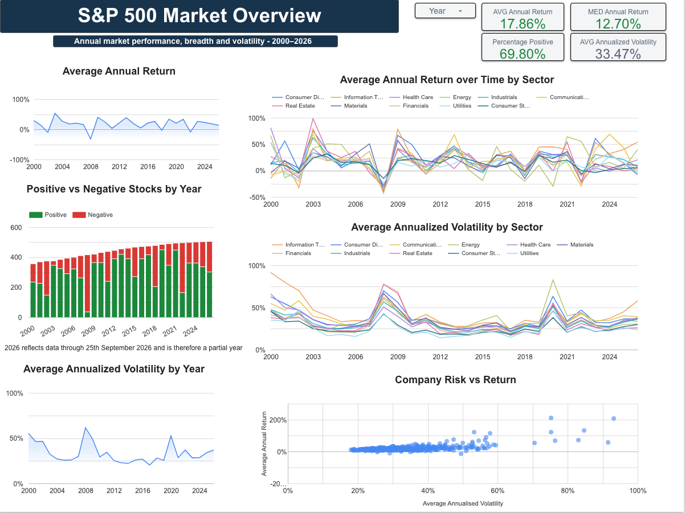
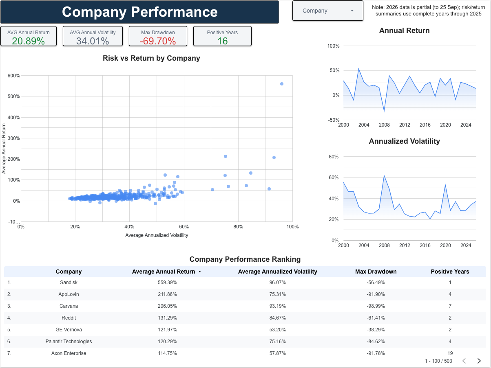
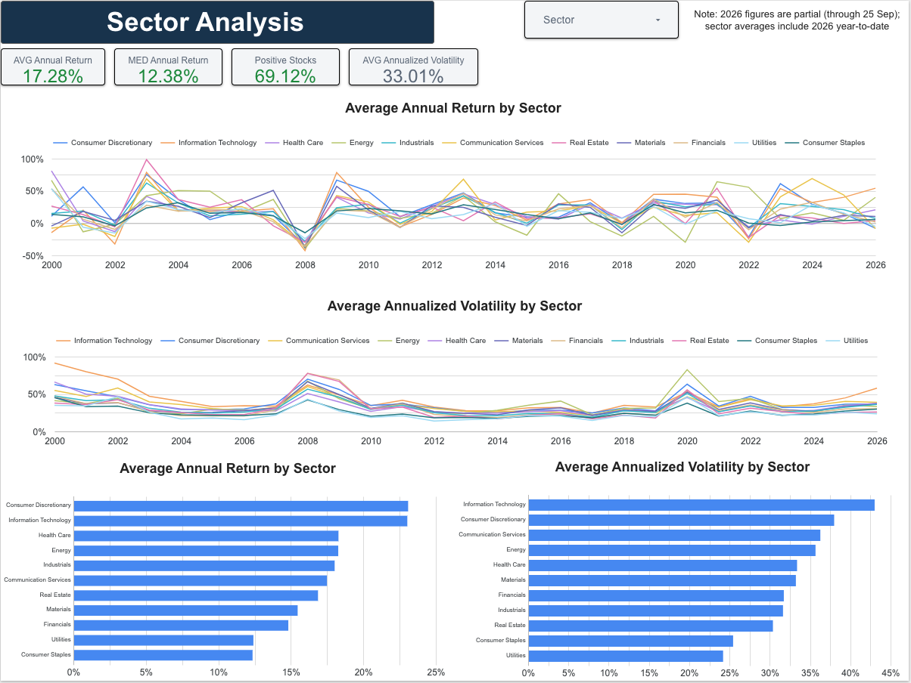
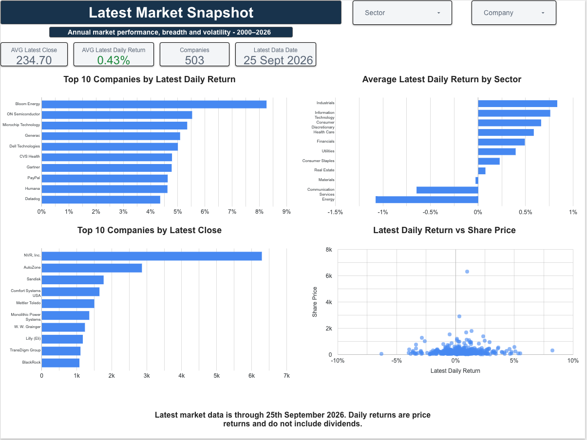

# S&P 500 Market Analysis Dashboard

## Executive Summary

How have S&P 500 companies performed over time, which sectors have experienced the greatest volatility, and how does risk vary between companies?

This project explores those questions using Python, SQL in Google BigQuery, and Looker Studio. I built a data analysis workflow that processes more than 2.9 million daily stock records and presents the results in a four-page interactive dashboard.

The focus is on turning raw financial data into useful comparisons: tracking annual performance, understanding risk, exploring sector trends, and reviewing the latest available stock data.

## Project Highlights

| Area | What I built |
|---|---|
| Data preparation | Validated, cleaned and transformed stock and company data using Python and pandas |
| Performance analysis | Calculated annual company returns and annualised volatility |
| Risk analysis | Compared company returns, volatility and maximum drawdown |
| Market analysis | Summarised positive and negative company returns across years |
| Sector analysis | Compared annual returns and volatility across sectors |
| Interactive reporting | Built a four-page Looker Studio dashboard connected to analytical tables in BigQuery |

## Interactive Dashboard

The dashboard is organised into four pages, each with a different focus. Filters, scorecards, charts and ranking tables allow users to explore the results from different angles.

### 1. Market Overview



An overview of annual market-wide performance, the balance of positive and negative company returns, sector trends, volatility and the relationship between company risk and return.

### 2. Company Performance



Compares annual returns, volatility and maximum drawdown across companies. A performance ranking table highlights historical returns, while the risk-versus-return chart provides additional context for comparing companies.

### 3. Sector Analysis



Explores annual returns and volatility across sectors, helping identify differences in performance and periods of greater market uncertainty.

### 4. Latest Market Snapshot



Shows the latest available closing prices and daily returns, alongside company and sector comparisons. Filters allow users to focus on specific parts of the market.

**Live dashboard:** [Explore the interactive S&P 500 Dashboard](https://datastudio.google.com/reporting/fc00f7b3-aa1e-40fd-b579-a7905d64a70c)

## Data and Methodology

### Data source

The project uses the Kaggle dataset *S&P 500 Stocks: 25 Years of Data (Updated Daily)* by darkmatternet. It contains daily stock price and trading-volume data alongside company information.

The source data used in this project contains more than 2.9 million daily records across 503 stock symbols, covering 3 January 2000 to 25 September 2026.

### Analysis workflow

1. **Data validation and preparation:** Python and pandas were used to inspect missing values, duplicate records, date ranges and company-symbol coverage, then prepare the datasets for analysis.
2. **Company performance:** SQL in BigQuery was used to calculate annual returns, annualised volatility and company-level performance measures.
3. **Risk analysis:** Additional queries summarised maximum drawdown and compared company risk with returns.
4. **Market and sector summaries:** SQL queries aggregated company-level results by year and sector, including the proportion of companies with positive annual returns.
5. **Visualisation:** Looker Studio connected to the BigQuery outputs to present the results through interactive charts, scorecards, filters and ranking tables.

### Key measures

- **Annual return:** The percentage change between the first and last recorded closing prices for a company within a calendar year.
- **Annualised volatility:** A measure of how much daily returns fluctuate, scaled to an annual basis.
- **Maximum drawdown:** The largest peak-to-trough decline in the observed closing-price series.
- **Market return breadth:** The number and proportion of companies with positive or negative annual returns.

Market-wide annual summaries describe the distribution of company-level returns. They are not official S&P 500 index returns.

## Technology Stack and Skills

| Technology | Application |
|---|---|
| Python | Data validation, preparation and analysis |
| pandas | Data cleaning, transformations and calculations |
| Google BigQuery | SQL analysis and analytical tables |
| SQL | Joins, aggregations, window functions and performance calculations |
| Looker Studio | Interactive dashboard design and reporting |
| Git and GitHub | Version control and project documentation |

This project brings together data preparation, analytical SQL, financial performance measures, dashboard development and documentation in one end-to-end workflow.

## Repository Structure

```text
S&P500_Looker_Project/
├── Data/                 # Local datasets and generated CSV files
├── screenshots/          # Dashboard screenshots used in this README
├── sql/                  # BigQuery analysis queries
├── check_data.py         # Company dataset validation
├── check_stock_data.py   # Stock data validation and analysis workflow
├── requirements.txt      # Python dependencies
├── README.md             # Project documentation
└── .gitignore            # Files excluded from version control
```

Raw data and generated CSV files are excluded from GitHub to keep the repository manageable. The SQL scripts, Python scripts and documentation are included so the approach can be reviewed.

## Reproducing the Analysis

To run the Python workflow locally, first obtain the required source datasets separately and place them in the `Data/` directory.

Install the project dependencies:

```bash
python -m pip install -r requirements.txt
```

Run the validation scripts:

```bash
python check_data.py
python check_stock_data.py
```

Recreating the full analysis requires a Google Cloud project, the relevant BigQuery datasets and tables, and appropriate access permissions. Recreating the dashboard also requires connecting Looker Studio to the analytical tables and configuring the report.

## Limitations

- **Price returns exclude dividends.** The source data does not provide adjusted closing prices, so the calculated returns do not represent total shareholder returns.
- **Survivorship bias:** The dataset does not provide a complete point-in-time record of historical S&P 500 membership. Historical comparisons may therefore be affected by changes in index membership.
- **Partial-year data:** 2026 observations run through 25 September 2026. These figures represent a partial year and should not be compared directly with full calendar years without this qualification.
- **Latest data is not live:** The dashboard reflects the latest date available in the dataset, rather than a live market feed.
- **Market-wide returns:** The market summary describes company-level returns and does not represent the official return of the S&P 500 index.

## Future Improvements

Potential next steps include refining the dashboard further, adding market benchmarks for comparison, and incorporating adjusted-price data to support total-return analysis.